# AA1 – Diagnosi DNS

**Alumne:** Aleix Bueno  
**Cicle formatiu:** CFGM2SMXA  
**Mòdul:** SERVEIS EN XARXA  
**Sistema operatiu:** Zorin OS (VirtualBox)  
**Data:** 05/11/2026

---

# 1. Introducció

En aquesta activitat s'estudia el funcionament del sistema DNS (Domain Name System), que permet traduir noms de domini en adreces IP.

L'objectiu és entendre com funciona la resolució de noms, conèixer els diferents tipus de servidors DNS i registres, i realitzar proves pràctiques amb eines com `dig`, `nslookup` i Avahi.

Les pràctiques s'han realitzat en una màquina virtual amb Zorin OS utilitzant VirtualBox. També es farà una comprovació des d'un segon dispositiu amb Windows.

# 2. Què és el DNS?

El DNS (Domain Name System) és un sistema distribuït i jeràrquic que s'encarrega de relacionar els noms de domini amb les adreces IP corresponents.

Per exemple, quan escrivim `www.google.com` al navegador, el sistema DNS busca quina adreça IP correspon a aquest nom perquè l'ordinador pugui connectar-se al servidor correcte.

Sense DNS hauríem de recordar les adreces IP de totes les pàgines web que volem visitar.

## 2.1. Funcions principals del DNS

- Traduir noms de domini a adreces IP.
- Permetre la localització de servidors i serveis.
- Facilitar l'ús d'Internet sense haver de recordar adreces IP.
- Gestionar la informació dels dominis mitjançant registres DNS.
- Permetre la resolució inversa, és a dir, obtenir un nom a partir d'una adreça IP.

# 3. Jerarquia del DNS

El sistema DNS està organitzat de manera jeràrquica, com un arbre invertit.

Els nivells principals són:

1. **Arrel (`.`):** és el nivell superior del sistema DNS.
2. **Dominis de primer nivell (TLD):** com `.com`, `.org`, `.cat` o `.es`.
3. **Dominis de segon nivell:** com `tecnocampus` dins de `tecnocampus.cat`.
4. **Subdominis:** com `www` dins de `www.tecnocampus.cat`.

Per exemple, en el domini `www.tecnocampus.cat`, es llegeix la jerarquia de dreta a esquerra: primer `.cat`, després `tecnocampus` i finalment `www`.

# 4. Tipus de servidors DNS

Els principals tipus de servidors DNS són:

- **Servidor DNS recursiu:** rep les peticions dels clients i busca la resposta necessària.
- **Servidor arrel:** indica a quin servidor s'ha de consultar per continuar la resolució.
- **Servidor TLD:** gestiona informació dels dominis de primer nivell, com `.com` o `.cat`.
- **Servidor autoritatiu:** conté la informació oficial d'un domini i les seves zones DNS.

## 4.1. Resolució recursiva i iterativa

**Resolució recursiva:** el servidor DNS consultat s'encarrega de buscar la resposta completa i retornar-la al client.

**Resolució iterativa:** el servidor consultat pot indicar quin altre servidor s'ha de consultar per continuar la cerca.

# 5. Registres DNS

Els registres DNS contenen informació sobre els dominis.

| Registre | Funció |
|---|---|
| A | Relaciona un nom amb una adreça IPv4. |
| AAAA | Relaciona un nom amb una adreça IPv6. |
| NS | Indica els servidors DNS autoritatius d'un domini. |
| SOA | Conté informació administrativa de la zona DNS. |
| MX | Indica els servidors de correu electrònic. |
| CNAME | Crea un àlies d'un altre nom de domini. |
| PTR | Permet la resolució inversa d'una IP a un nom. |
| TXT | Emmagatzema informació textual, sovint utilitzada per verificacions i seguretat. |

# 6. mDNS i Avahi

mDNS (Multicast DNS) és un sistema que permet resoldre noms dins d'una xarxa local sense necessitar un servidor DNS centralitzat.

Utilitza habitualment el domini `.local` i el port UDP 5353.

Les adreces multicast utilitzades són:

- IPv4: `224.0.0.251`
- IPv6: `FF02::FB`

A Linux es pot utilitzar Avahi per gestionar la resolució de noms mDNS i descobrir dispositius de la xarxa local.

Per exemple, un ordinador amb el nom `aleix-VirtualBox` pot ser accessible mitjançant `aleix-VirtualBox.local`.

# 7. Mapa conceptual

El mapa conceptual resumeix els conceptes principals del sistema DNS:

- **Funcions:** traducció de noms, resolució directa i inversa.
- **Jerarquia:** arrel, TLD, domini i subdomini.
- **Arquitectura:** servidors recursius, arrel, TLD i autoritatius.
- **Resolució:** procés de consulta recursiva i iterativa.
- **Registres:** A, AAAA, NS, SOA, MX, CNAME, PTR i TXT.
- **mDNS:** resolució de noms locals mitjançant `.local` i Avahi.

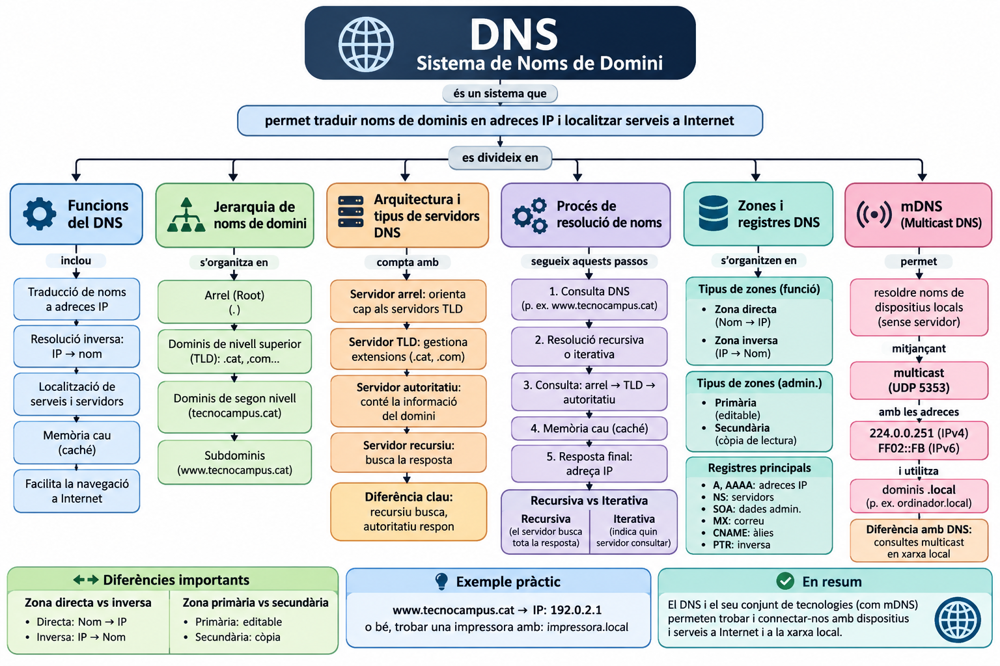

# 8. Vídeo explicatiu individual

En aquesta part s'ha de presentar un vídeo explicant el funcionament del DNS i els conceptes principals treballats en l'activitat.

**Enllaç al vídeo:** [ENGANXA AQUÍ L'ENLLAÇ DEL VÍDEO]

# 9. Part pràctica: diagnosi DNS

Les proves pràctiques s'han realitzat amb Zorin OS dins de VirtualBox.

## 9.1. Configuració de xarxa de VirtualBox

S'ha comprovat la configuració dels adaptadors de xarxa de la màquina virtual.

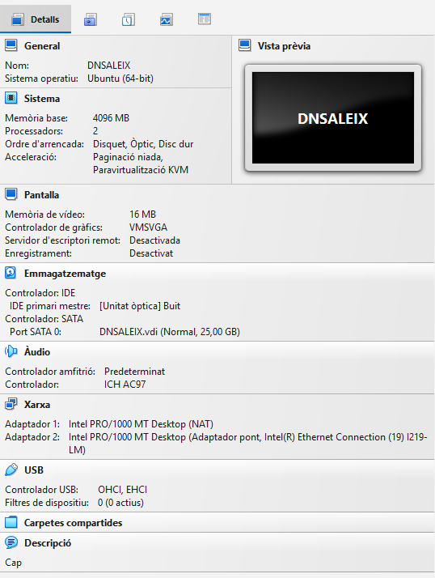

## 9.2. Comprovació de les interfícies de xarxa

S'ha utilitzat l'ordre:

```bash
ip a
```

Resultats obtinguts:

- La interfície `enp0s3` utilitza NAT i té l'adreça IPv4 `10.0.2.15/24`.
- La interfície `enp0s8` està activa en mode pont, però no ha obtingut cap adreça IPv4. Només disposa d'una adreça IPv6 local d'enllaç.

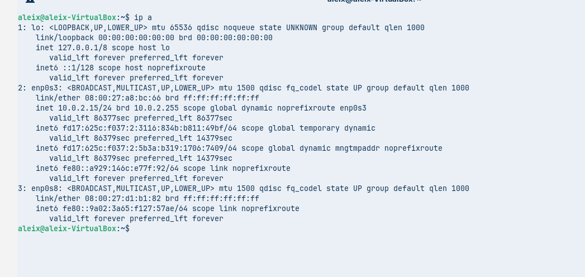

## 9.3. Consulta DNS de tipus A amb dig

S'ha executat:

```bash
dig tecnocampus.cat A
```

La consulta ha retornat una resposta correcta (`NOERROR`) amb les adreces IPv4 següents:

- `18.172.213.8`
- `18.172.213.22`
- `18.172.213.110`
- `18.172.213.97`

El servidor DNS utilitzat és `127.0.0.53`, que correspon al servei de resolució local del sistema.

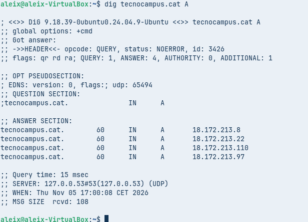

## 9.4. Consulta dels servidors NS

S'ha executat:

```bash
dig tecnocampus.cat NS
```

Els servidors de noms trobats són:

- `ns-1071.awsdns-05.org`
- `ns-1689.awsdns-19.co.uk`
- `ns-130.awsdns-16.com`
- `ns-535.awsdns-02.net`

Aquests servidors són els responsables de gestionar les consultes DNS autoritatives del domini.

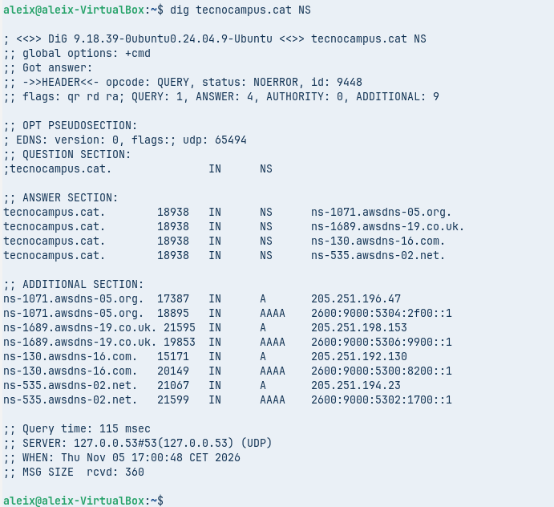

## 9.5. Consulta del registre SOA

S'ha executat:

```bash
dig tecnocampus.cat SOA
```

La resposta mostra la informació administrativa de la zona DNS:

- **Servidor principal:** `ns-1071.awsdns-05.org`
- **Contacte administratiu:** `awsdns-hostmaster.amazon.com`
- **Número de sèrie:** `1`
- **Refresh:** `7200`
- **Retry:** `900`
- **Expire:** `1209600`
- **Minimum:** `86400`

El registre SOA permet conèixer informació important sobre l'administració i actualització de la zona DNS.

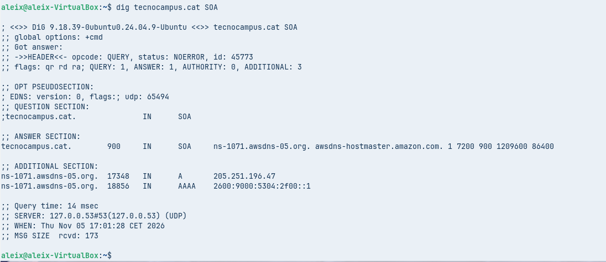

## 9.6. Consulta inversa amb PTR

S'ha executat:

```bash
dig -x 18.172.213.8
```

La resposta obtinguda ha estat:

`server-18-172-213-8.bcn50.r.cloudfront.net`

Aquesta consulta permet obtenir el nom associat a una adreça IP mitjançant un registre PTR.

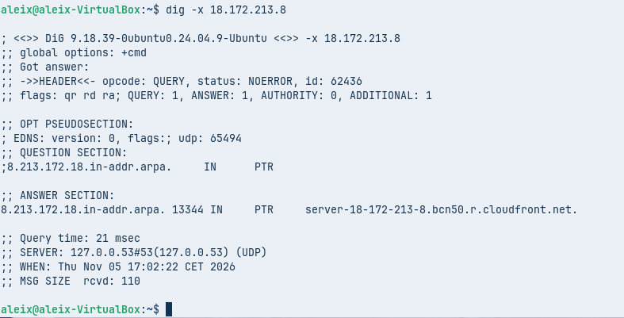

## 9.7. Consulta amb nslookup no autoritativa

S'ha utilitzat:

```bash
nslookup tecnocampus.cat
```

La consulta ha retornat diverses adreces IP:

- `108.157.113.90`
- `108.157.113.8`
- `108.157.113.83`
- `108.157.113.59`

La resposta és no autoritativa, perquè prové d'un servidor DNS que ha obtingut la informació d'un altre servidor o la té emmagatzemada a la memòria cau.

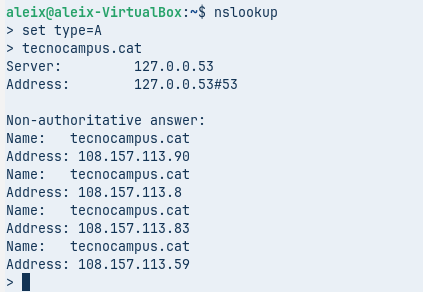

## 9.8. Consulta amb nslookup a un servidor autoritatiu

S'ha consultat directament el servidor DNS:

```bash
nslookup tecnocampus.cat ns-1071.awsdns-05.org
```

El servidor consultat correspon a `ns-1071.awsdns-05.org`, amb l'adreça IP `205.251.196.47`.

La consulta ha retornat les adreces:

- `18.172.213.22`
- `18.172.213.97`
- `18.172.213.8`
- `18.172.213.110`

Aquesta prova permet consultar directament un dels servidors autoritatius del domini.

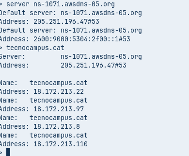

## 9.9. Comprovació del nom de l'equip

S'ha executat:

```bash
hostname
```

El nom de l'equip és:

`aleix-VirtualBox`

Aquest nom identifica la màquina virtual dins del sistema.

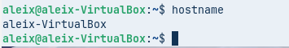

## 9.10. Comprovació del servei Avahi

S'ha comprovat l'estat del servei amb:

```bash
systemctl status avahi-daemon
```

El resultat indica que el servei Avahi està actiu i en execució (`active (running)`).

Avahi permet utilitzar mDNS per descobrir i resoldre noms de dispositius dins de la xarxa local.

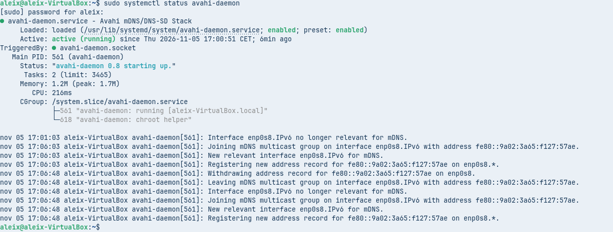

## 9.11. Resolució del nom local amb Avahi

S'ha executat:

```bash
avahi-resolve-host-name aleix-VirtualBox.local
```

La consulta ha retornat l'adreça IPv6:

`fd17:625c:f037:2:5b3a:b319:1706:7409`

Això demostra que el nom local es pot resoldre mitjançant mDNS.

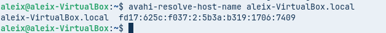

## 9.12. Comprovació de connectivitat amb ping

S'ha executat:

```bash
ping -c 4 aleix-VirtualBox.local
```

El nom s'ha resolt a l'adreça IPv4 `10.0.2.15`.

S'han enviat 4 paquets i s'han rebut 4, amb un 0% de pèrdua de paquets. El temps mitjà de resposta ha estat aproximadament de `0,042 ms`.

Aquesta prova confirma que el nom local es resol i que hi ha connectivitat amb l'adreça obtinguda.

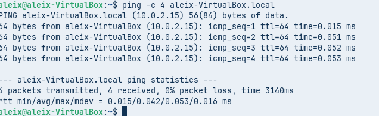

# 10. Prova de mDNS des d'un segon dispositiu (Windows)

L'objectiu d'aquesta prova és comprovar si un segon dispositiu connectat a la mateixa xarxa local pot resoldre el nom de la màquina virtual mitjançant mDNS.

En aquest cas, s'utilitzarà un ordinador amb Windows per intentar accedir a la màquina virtual Zorin OS mitjançant el nom:

`aleix-VirtualBox.local`

## 10.1. Comprovació de la xarxa de Windows

Primer, cal comprovar que l'ordinador Windows està connectat a la mateixa xarxa local que la màquina virtual.

Obrim el símbol del sistema (CMD) i executem:

```cmd
ipconfig
```

Amb aquesta ordre podem consultar l'adreça IP i la configuració de xarxa de Windows.

**Captura:** `captures/13_windows_ipconfig.png`

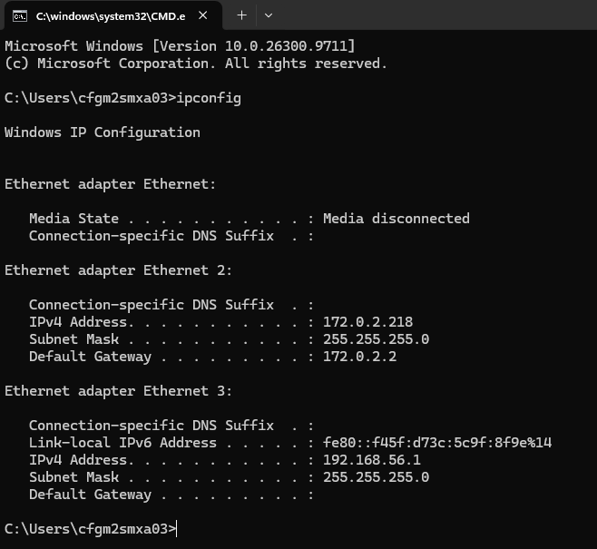

## 10.2. Comprovació de la resolució mDNS des de Windows

Des de l'ordinador amb Windows, s'ha obert el símbol del sistema (CMD) i s'ha executat:

```cmd
ping aleix-VirtualBox.local
```

El resultat ha estat:

```text
Pinging aleix-VirtualBox.local [10.0.2.15] with 32 bytes of data:
Request timed out.
Request timed out.
Request timed out.
Request timed out.

Ping statistics for 10.0.2.15:
Packets: Sent = 4, Received = 0, Lost = 4 (100% loss)
```

El resultat mostra que Windows ha pogut resoldre correctament el nom `aleix-VirtualBox.local` i l'ha associat amb l'adreça IP `10.0.2.15`.

Tot i això, la comunicació mitjançant ping no ha funcionat, ja que no s'ha rebut cap resposta i s'han perdut els quatre paquets enviats.

Això indica que la resolució del nom mDNS ha funcionat, però que encara hi ha un problema de connectivitat entre Windows i la màquina virtual.

**Captura:** `captures/14_windows_ping.png`

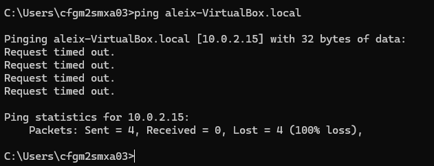

## 10.3. Comprovació addicional de connectivitat per IP

S'ha intentat preparar una prova de connectivitat des de Windows directament a l'adreça IP de la màquina virtual Zorin OS.

No s'ha pogut completar aquesta prova perquè la interfície de xarxa `enp0s8`, configurada en mode pont a VirtualBox, no disposa d'una adreça IPv4.

Per aquest motiu, no s'ha pogut executar el ping a través de la xarxa local.

**Resultat:** prova pendent per manca d'una adreça IPv4 a la interfície en mode pont.

## 10.4. Conclusions de la prova amb Windows

La prova realitzada des de Windows ha permès comprovar que el nom `aleix-VirtualBox.local` es resol correctament mitjançant mDNS, ja que s'ha obtingut l'adreça IP `10.0.2.15`.

No obstant això, el ping no ha rebut resposta i s'ha produït una pèrdua del 100% dels paquets.

Per tant, es pot afirmar que la resolució del nom ha funcionat, però que la comunicació entre Windows i la màquina virtual encara no s'ha pogut confirmar correctament.

Cal revisar la configuració de xarxa de VirtualBox, especialment l'adaptador en mode pont, per aconseguir que la màquina virtual tingui una adreça IP accessible des de Windows.

**Conclusió final:** la resolució mDNS ha funcionat, però la connectivitat entre els dos dispositius queda pendent de solucionar.

# 11. Conclusions generals

Amb aquesta activitat he après com funciona el sistema DNS i com permet traduir noms de domini en adreces IP.

He pogut comprovar diferents tipus de registres DNS, com A, NS, SOA i PTR, utilitzant l'eina `dig`. També he utilitzat `nslookup` per consultar informació DNS i diferenciar entre consultes no autoritatives i consultes directes a un servidor autoritatiu.

A més, he après què és mDNS i com funciona Avahi a Linux per resoldre noms dins d'una xarxa local mitjançant el domini `.local`.

Les proves realitzades dins de la màquina virtual han funcionat correctament. Des de Windows també s'ha pogut resoldre el nom `aleix-VirtualBox.local`, tot i que la comunicació mitjançant ping ha quedat pendent per un problema de connectivitat.

En general, l'activitat m'ha servit per entendre millor la resolució de noms i aprendre a utilitzar eines de diagnosi de xarxa.

# 12. Ús de la intel·ligència artificial

Per realitzar aquesta activitat he utilitzat ChatGPT com a eina de suport per entendre els conceptes del DNS, interpretar els resultats de les ordres executades i organitzar la documentació de la pràctica.

La informació i els resultats pràctics s'han revisat tenint en compte les proves realitzades a la màquina virtual.

**Enllaç a la conversa de ChatGPT:**

https://chatgpt.com/share/6aecc4c9-3f70-83eb-8ee6-447c4a4996a1

https://chatgpt.com/share/6aeccecc-4128-83eb-98d9-b40274ee6d92
---

**Fi de l'activitat AA1 – Diagnosi DNS**